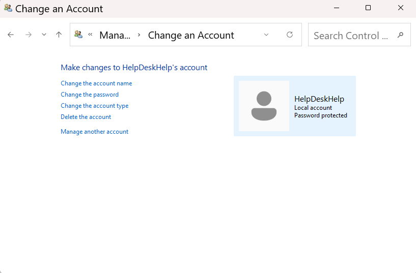
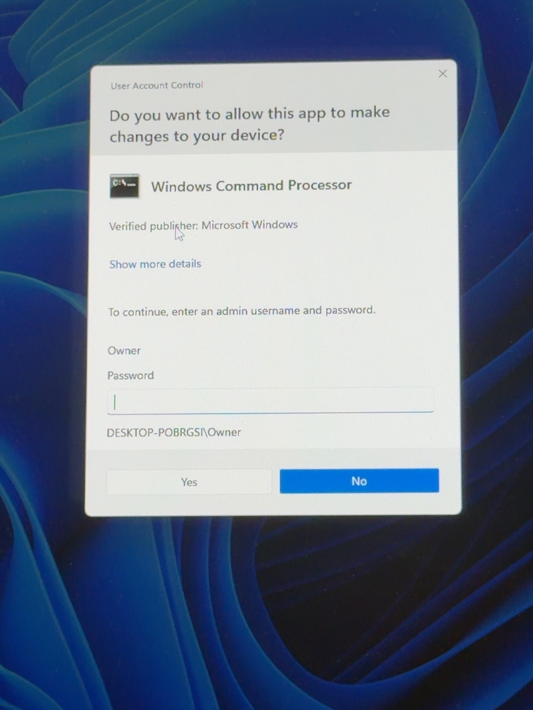

# Lab 2: Windows Local User Account Management

## Objective
Create a local Windows user account, verify its permissions, and practice basic account management tasks used in Tier 1 IT support.

## Help Desk Scenario
A new employee needs a local Windows account on a workstation. The Help Desk technician must create the account and verify that it has standard user permissions.

## Environment
- Operating System: Windows 11
- Tools: Windows Settings and Control Panel
- Test Account: HelpDeskHelp

## Steps Performed

### 1. Created a Local User Account
- Opened Settings > Accounts > Other users.
- Selected Add account.
- Chose to create an account without a Microsoft account.
- Created the local account named HelpDeskHelp.
- Configured password protection.

### 2. Verified User Permissions
- Opened Change account type in Windows Settings.
- Confirmed HelpDeskHelp was configured as a Standard User.
- Left the account permissions unchanged.

### 3. Inspected the Account in Control Panel
- Opened Control Panel using Windows + R and the `control` command.
- Navigated to User Accounts > Change account type.
- Located HelpDeskHelp.
- Verified that Windows identified it as a local, password-protected account.

## Results
Successfully created a password-protected local Windows account and verified its Standard User permissions.

### Screenshot: Local User Account

### Administrator Permission Test

Signed into the HelpDeskHelp Standard User account and attempted to launch Command Prompt using "Run as administrator."

Windows displayed a User Account Control (UAC) prompt requesting credentials for the Owner administrator account.

Selected "No" to cancel the request without making system changes.

**Result:** Confirmed that the Standard User account requires administrator authorization to perform elevated actions.

### Screenshot: User Account Control

**Security Concept:** Principle of Least Privilege — users should only receive the permissions necessary to perform their tasks.
  

## Key Takeaways
- Local accounts are created and managed on an individual Windows computer.
- Standard users have fewer system-level permissions than administrators.
- Using standard accounts helps reduce unnecessary administrative access.
- Windows Settings and Control Panel provide tools for managing local users.

## Skills Demonstrated
- Windows 11 user account management
- Local account creation
- User permission verification
- Basic access control
- Technical documentation

## Next Steps
- Test signing in with the new account.
- Explore administrator permission prompts.
- Practice additional account troubleshooting scenarios.
