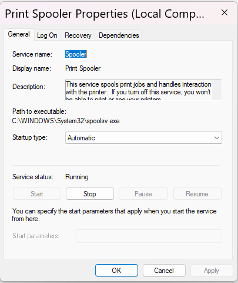
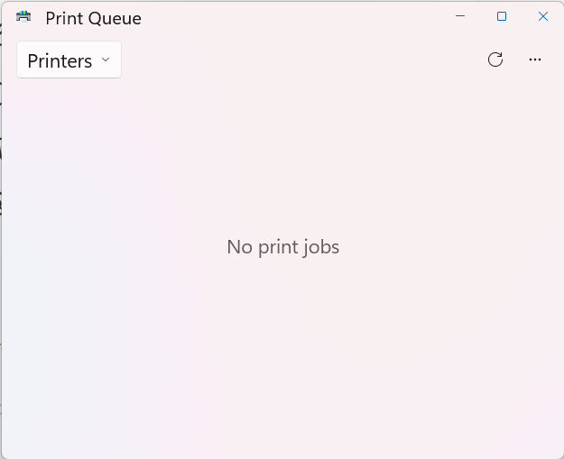

# Lab 04 — Windows Services and Print Spooler Troubleshooting

## Objective
Learn how to inspect Windows services, identify service status and startup configurations, and troubleshoot a simulated printing issue using Windows 11.

## Help Desk Scenario
A user reports that documents are not printing. The printer appears available, but the cause of the issue is unknown.

This was a simulated support scenario. No actual printer failure was observed.

## Tools Used
- Windows Services (`services.msc`)
- Windows 11 Settings
- Microsoft Print to PDF
- Notepad
- File Explorer

## Troubleshooting Steps
1. Opened Windows Services using `services.msc`.
2. Inspected Windows Search and confirmed it was Running with startup type Automatic (Delayed Start).
3. Located Print Spooler and verified its startup type was Automatic and service status was Running.
4. Opened Microsoft Print to PDF and inspected its print queue, which was empty.
5. Created a test document in Notepad.
6. Printed the test document using Microsoft Print to PDF and saved it as `Lab-04-Print-Spooler-Test.pdf`.
7. Verified the PDF file was created and had a size of 36.0 KB.
8. Reopened the print queue and confirmed it displayed No print jobs.

## Results
The Print Spooler service was running, and the Microsoft Print to PDF test generated a nonempty PDF file. The print queue was empty after the test, consistent with successful processing. No actual service failure was diagnosed or repaired.

## What I Learned
- How to inspect Windows service status and startup types.
- Why it is important to investigate before restarting services.
- How to check a print queue for pending jobs.
- How to test virtual printing without a physical printer.
- How to record troubleshooting evidence for a support ticket.

## Screenshots

### Print Spooler Service Configuration

### Print Queue After Test

## Next Steps
Practice troubleshooting a simulated stuck print job and learn when restarting the Print Spooler is appropriate.
