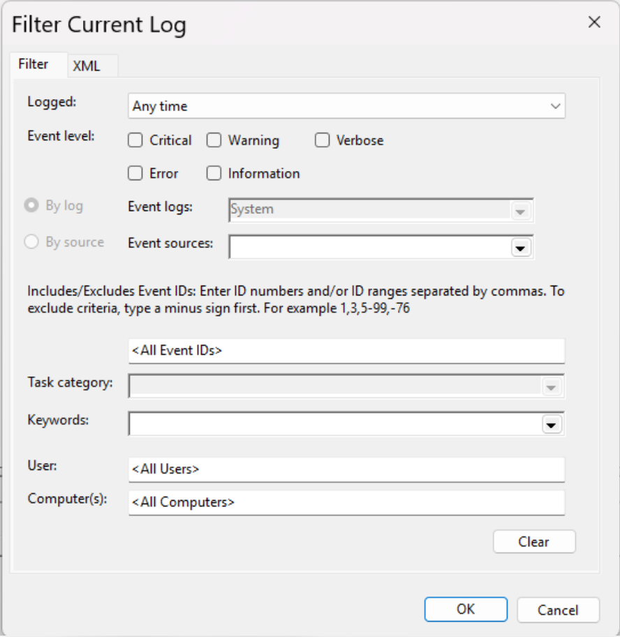
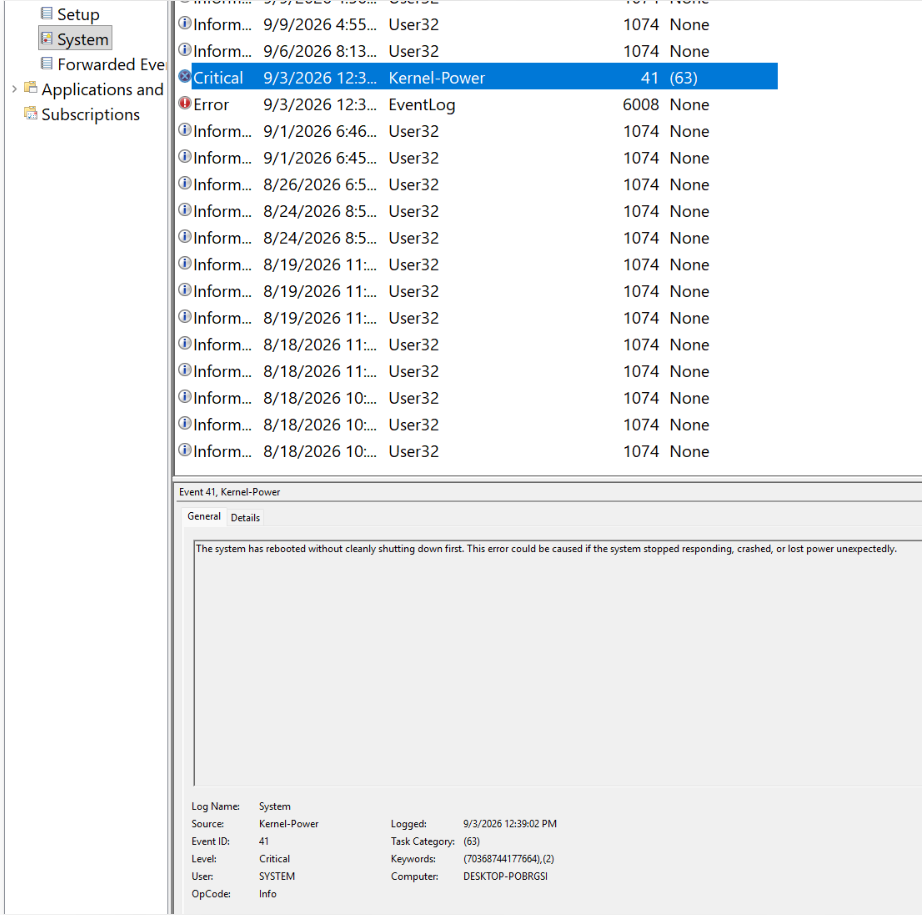
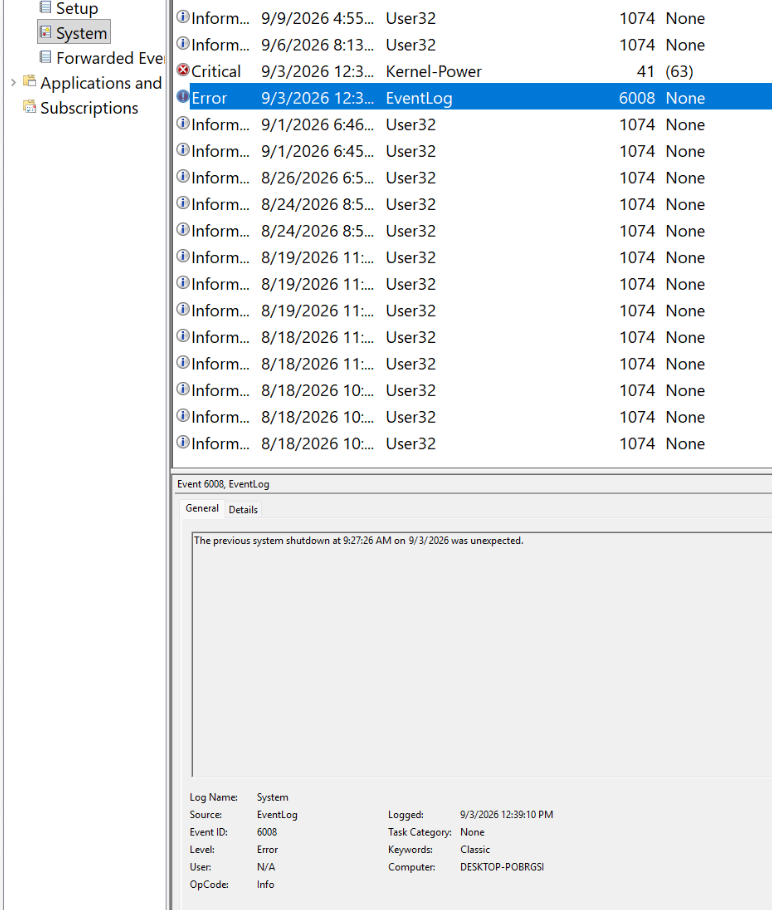

# Lab 05 — Windows Event Viewer Troubleshooting

## Objective
Learn how to investigate Windows system events, identify relevant Event IDs, correlate log entries, and determine the likely cause of an unexpected shutdown.

## Help Desk Scenario
A Windows 11 computer recorded an unexpected shutdown. The goal was to investigate the event logs, identify supporting evidence, and determine whether further troubleshooting was necessary.

This investigation used actual events recorded on my personal computer.

## Tools Used
- Windows Event Viewer (`eventvwr.msc`)
- Windows Logs — System
- Filter Current Log

## Troubleshooting Steps
1. Opened Event Viewer using `eventvwr.msc`.
2. Navigated to Windows Logs > System.
3. Reviewed event levels, sources, Event IDs, and event descriptions.
4. Investigated a Service Control Manager error (Event ID 7023) and correlated it with Kernel-Power Events 109 and 577, which showed a reboot was in progress.
5. Used Filter Current Log to search for Event IDs `41,6008,1074`.
6. Identified Kernel-Power Event ID 41, logged on September 3, 2026, at 12:39:02 PM.
7. Identified EventLog Event ID 6008, which reported an unexpected shutdown at 9:27:26 AM on September 3, 2026.
8. Compared the event information and investigated the circumstances surrounding the shutdown.
9. Recalled that household electrical power had been disconnected without warning while the computer was running.
10. Confirmed that the computer had continued operating normally afterward.

## Findings
- Event ID 41 indicated that Windows restarted without completing a clean shutdown.
- Event ID 6008 confirmed that the previous shutdown was unexpected.
- The reported household power interruption was consistent with both events.
- The exact cause could not be proven from the event logs alone.
- No recurring instability or hardware problems were reported.

## Results
The most likely explanation was an unexpected loss of household electrical power. Because the computer was operating normally afterward, no configuration changes or hardware repairs were performed.

## What I Learned
- How to navigate and interpret Windows Event Viewer.
- How to identify event sources, severity levels, and Event IDs.
- How to filter System logs for specific events.
- How to correlate multiple events to investigate a problem.
- Why a Critical or Error event does not automatically identify the root cause.
- Why asking the user about what happened is an important part of troubleshooting.
- How to document findings without claiming an unverified repair.

## Screenshots

### Filtered System Events

### Kernel-Power — Event ID 41

### EventLog — Event ID 6008

## Next Steps
Continue practicing Event Viewer investigations, including application crashes and Windows service failures.
